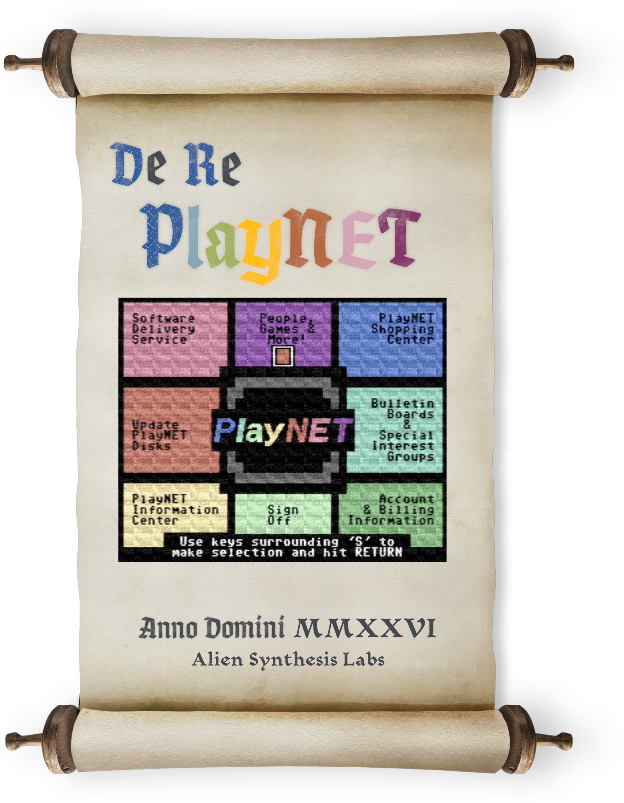

Prologue: [The Apprentice and The Genie](docs/prologue.md)

# ~De Re PlayNET Table of Contents

[Introduction](docs/introduction.md)

|Chapter|Status|
|---|---|
|**PART ONE / CLIENT ENGINE**||
|[1. A (Very) Brief History](/docs/chapter1.md)|*Complete*|
|[2. The Static View](/docs/chapter2.md)|*Complete*|
|[3. Bootstrapping and the Dialer](/docs/chapter3.md)|*Complete*|
|[4. Session Establishment and the Client/Server Protocol](/docs/chapter4.md)|*Complete*|
|[5. The Application Finite State Machine (FSM)](/docs/chapter5.md)|*Under Construction*|
|**PART TWO / MODULES, GAMES, AND MORE**||
|6. Modules|*Coming Soon*|
|7. Games|*Coming Soon*|
|8. Uploads and Downloads|*Coming Soon*|
|**PART THREE / CONCLUSION**||
|9. Product Evolution|*Coming Soon*|

[Credits](docs/credits.md)

